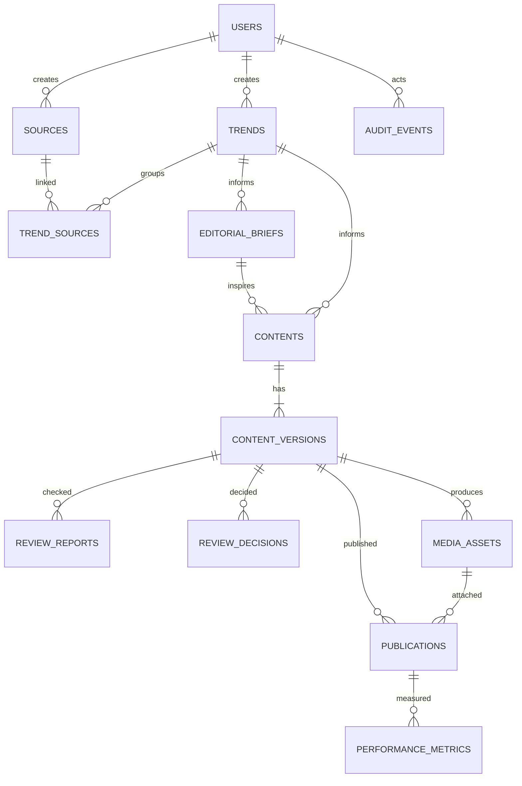

# Entity Relationship Design (ERD)

## 1. Core entities
### users
Single operator initially; keep a user table to support audit and future collaboration.
- `id` UUID PK
- `email` unique
- `display_name`
- `password_hash` or external auth subject (implementation decision)
- `created_at`, `updated_at`

### sources
- `id` UUID PK
- `url` nullable
- `normalized_url` nullable unique where present
- `platform` enum/string
- `source_type` enum/string
- `title` nullable
- `operator_note` nullable
- `content_fingerprint` nullable
- `permission_status`: unknown | permitted | permission_required | restricted | rejected
- `verification_status`: unverified | partially_verified | verified | disputed | not_applicable
- `attribution` nullable
- `discovered_at`
- `archived_at` nullable
- `created_by` FK users
- timestamps

Do not store scraped full text by default. If a future approved use case stores excerpts, add retention and permission controls.

### trends
- `id` UUID PK
- `title`
- `summary`
- `category`
- `tags` JSONB
- `status`: active | cooling | expired | archived
- `relevance_score` numeric
- `freshness_score` numeric
- `novelty_score` numeric
- `discussion_score` numeric
- `evidence_score` numeric
- `risk_penalty` numeric
- `overall_score` numeric
- `confidence` numeric
- `expires_at`
- `created_by` FK users
- timestamps

### trend_sources
Join table:
- `trend_id` FK trends
- `source_id` FK sources
- `relationship_note`
- composite PK `(trend_id, source_id)`

### editorial_briefs
- `id` UUID PK
- `trend_id` FK trends nullable
- `title`
- `target_audience`
- `core_tension`
- `context_summary`
- `verified_facts` JSONB
- `claims_and_allegations` JSONB
- `unknowns` JSONB
- `safe_angle`
- `recommended_format`
- `source_map` JSONB
- `created_by`
- timestamps

### contents
Represents the editorial content item.
- `id` UUID PK
- `brief_id` FK editorial_briefs nullable
- `trend_id` FK trends nullable
- `title`
- `format`: short_video | carousel | text_post
- `status`: draft | in_review | changes_requested | approved | rejected | producing | ready_to_publish | published | archived
- `current_version_id` nullable FK content_versions
- `created_by`
- timestamps

### content_versions
Immutable revisions:
- `id` UUID PK
- `content_id` FK contents
- `version_number` integer
- `angle`
- `hook`
- `script`
- `caption`
- `cta`
- `pinned_comment` nullable
- `estimated_duration_seconds`
- `scene_plan` JSONB
- `source_references` JSONB
- `editorial_labels` JSONB
- `edited_by_human` boolean
- `created_by`
- `created_at`
- unique `(content_id, version_number)`

### ai_runs
- `id` UUID PK
- `task_type`
- `entity_type`, `entity_id`
- `provider`
- `model`
- `prompt_name`
- `prompt_version`
- `input_tokens`, `output_tokens`
- `estimated_cost`
- `latency_ms`
- `status`: queued | running | succeeded | failed
- `error_code`, `error_summary`
- `created_at`, `completed_at`

### review_reports
- `id` UUID PK
- `content_version_id` FK content_versions
- `overall_risk`: low | medium | high | critical
- `findings` JSONB
- `recommendation`: pass | revise | block
- `ai_run_id` FK ai_runs nullable
- `created_at`

### review_decisions
- `id` UUID PK
- `content_version_id` FK content_versions
- `reviewer_id` FK users
- `decision`: approved | changes_requested | rejected
- `notes`
- `checklist` JSONB
- `created_at`

### media_assets
- `id` UUID PK
- `content_version_id` FK content_versions
- `asset_type`: audio | subtitle | image | video | thumbnail
- `storage_key`
- `mime_type`
- `file_size_bytes`
- `duration_seconds` nullable
- `checksum`
- `status`: queued | processing | ready | failed
- `render_config` JSONB
- timestamps

### publications
- `id` UUID PK
- `content_version_id` FK content_versions
- `media_asset_id` FK media_assets nullable
- `platform`
- `channel_name`
- `post_url` nullable
- `platform_post_id` nullable
- `published_at`
- `recorded_by` FK users
- `created_at`

### performance_metrics
Append-only snapshots:
- `id` UUID PK
- `publication_id` FK publications
- `collected_at`
- `views`, `reach`, `likes`, `comments`, `shares`, `saves`, `follows` nullable bigint
- `average_watch_seconds` nullable numeric
- `completion_rate` nullable numeric
- `raw_metrics` JSONB nullable
- `created_at`

### audit_events
- `id` UUID PK
- `actor_id` FK users nullable
- `action`
- `entity_type`
- `entity_id`
- `metadata` JSONB
- `created_at`

## 2. Relationships

## 3. Indexes and constraints
- Unique normalized URL when non-null.
- Unique `(content_id, version_number)`.
- Index source permission/verification/discovered_at.
- Index trends status/overall_score/expires_at.
- Index contents status/updated_at.
- Index AI runs entity and created_at.
- Index publications platform/published_at.
- Index metrics publication_id/collected_at.
- Use FK constraints and transaction-safe state transitions.
- JSONB is for variable structured payloads, not core relational identity.

## 4. State consistency
- `contents.current_version_id` must reference a version belonging to the same content.
- Approval must reference the exact immutable content version.
- Media asset must reference an approved version.
- Publication must reference a version with a successful human approval and final media confirmation.
- Metrics are append-only; corrections create a new snapshot or explicit correction record.
