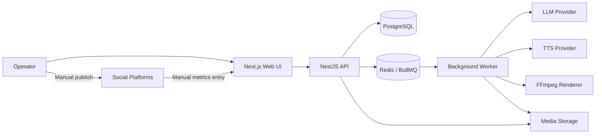
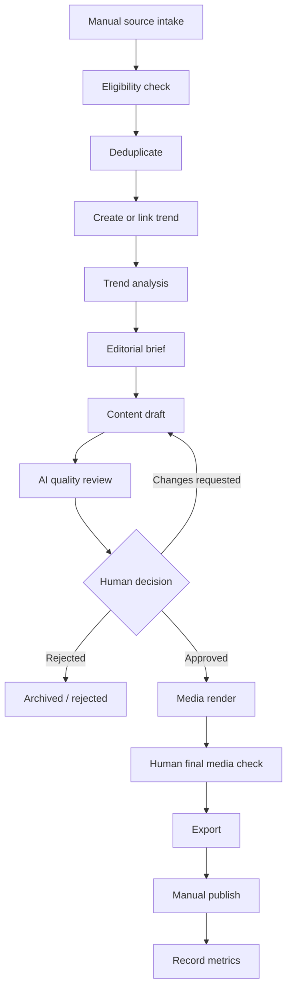

# High-Level Design (HLD)

## 1. Architecture choice
Use a **modular monolith** with asynchronous workers. This is the simplest architecture that supports the MVP and keeps domain boundaries clear. Do not split into microservices during initial validation.

## 2. Proposed stack
- Frontend: Next.js + TypeScript.
- Backend: NestJS + TypeScript.
- Database: PostgreSQL.
- ORM: Prisma (unless an ADR approves a change).
- Queue/cache: Redis + BullMQ.
- AI: provider abstraction over an LLM API; provider/model selected by environment/config.
- Media: FFmpeg; TTS provider behind adapter.
- Local development: Docker Compose.
- Storage: local filesystem in development; object storage adapter can be added later.
- Observability: structured application logs and persisted AI run/job records.

## 3. Logical components
### Web application
- Dashboard and workflow UI.
- Source and trend management.
- Brief/script editor.
- Review and approval screen.
- Media preview/export.
- Publication and analytics entry.

### API application
- Auth and operator identity.
- Source CRUD and eligibility.
- Trend and scoring services.
- Brief/content orchestration.
- Review and approval workflow.
- Media job orchestration.
- Publication/analytics CRUD.
- Cost reporting.

### Worker
- AI classification and clustering suggestions.
- Trend analysis.
- Brief/script generation.
- Quality review.
- TTS and FFmpeg render.
- Retry, timeout, and dead-letter handling.

### PostgreSQL
- Source provenance and editorial data.
- Content versions and approvals.
- AI run metadata.
- Media metadata and publication metrics.

### Redis/BullMQ
- Background job queues.
- Job status and retry state.
- No durable business truth should exist only in Redis.

## 4. Module boundaries
- `auth`: operator identity and access.
- `sources`: source intake, provenance, eligibility.
- `trends`: clustering, scoring, lifecycle.
- `research`: editorial brief and evidence mapping.
- `content`: content items and immutable versions.
- `ai`: provider adapters, prompt registry, structured output.
- `review`: findings, decisions, approval gates.
- `media`: TTS, subtitles, rendering, asset metadata.
- `publishing`: manual publication records.
- `analytics`: metric snapshots and reports.
- `costs`: usage and budget monitoring.
- `audit`: security- and workflow-relevant events.

## 5. System context

## 6. Main data flow

## 7. API conventions
- REST JSON under `/api/v1`.
- Use UUIDs for public resource IDs.
- Standard error shape: `{ code, message, details?, correlationId }`.
- Pagination: cursor-based for large lists; page/limit acceptable for MVP lists.
- Date-time input/output in ISO 8601 UTC.
- Validate DTOs at controller boundaries.
- Use idempotency keys for expensive generation/render requests.

## 8. Async jobs
Queues:
- `ai-analysis`
- `content-generation`
- `quality-review`
- `media-render`
- `analytics-import` (reserved; manual in MVP)

Job requirements:
- Persist a corresponding `ai_runs` or `media_jobs` record.
- Retry transient errors with exponential backoff and bounded attempts.
- Do not retry policy/validation errors.
- Jobs must be idempotent.
- Expose status and failure reason in UI.
- Dead-letter or terminal-failure state after max attempts.

## 9. Security and reliability
- Authentication for all app routes and API endpoints.
- Secrets only in environment variables/secret manager.
- Rate-limit AI endpoints.
- Restrict upload file types and sizes.
- Validate media paths to prevent path traversal.
- Keep source text untrusted.
- Backup PostgreSQL and media storage.
- Health checks for API, worker, PostgreSQL, and Redis.

## 10. Deployment approach
MVP local Docker Compose first. Deploy only after local workflow is stable. A small VPS can host API/worker/database for validation, but production exposure requires TLS, firewall, backups, update policy, and secrets handling. Do not assume a low-cost VPS is sufficient for heavy video rendering.
